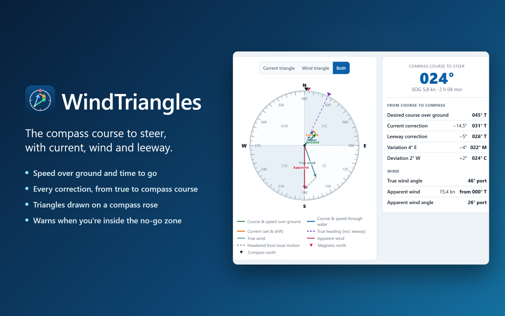

# WindTriangles

[](https://kreaton.github.io/WindTriangles/)
[](LICENSE)




**The compass course to steer, allowing for current, wind and leeway.**

**Live app: <https://kreaton.github.io/WindTriangles/>**

A sailing navigation aid that calculates the **compass course to steer**. You enter the desired course and distance, the boat speed, the current (set and drift), the wind (direction and speed), the leeway, the variation and the deviation. Press **Calculate**, and the app shows:

- the compass course, speed over ground and time to go
- each correction on the way from true course to compass course
- true and apparent wind angles, with a warning when the course is inside the no-go zone
- the current triangle and the wind triangle drawn as vectors on a compass rose with degree markings

It is a Blazor WebAssembly app (.NET 10) that runs entirely in the browser, with no server-side code. The layout adapts to PC, iPad and iPhone. It can be added to the home screen as an app (PWA manifest and Apple touch icons included).

The icons in `wwwroot/icons` are generated by `tools/make-icons.ps1`, which draws them as SVG and renders the PNG sizes with headless Edge. Run `pwsh tools/make-icons.ps1` to rebuild them after changing the design.

See [guide.md](guide.md) for the principles behind the calculation, with a worked example.

## Running locally

```bash
dotnet run --project src/WindTriangles
```

Then open http://localhost:5141.

## Versioning

The version is `Major.Minor.Build`. Major and minor are set by hand in `Directory.Build.props`. The build number is the GitHub Actions run number (0 for local builds). The footer shows the version, the build time (Danish time) and the git commit, for example `(c) Per Hejndorf, 2026 · v1.0.7 · 26.10.2026 14:32 · a1b2c3d`.

## CI/CD

`.github/workflows/deploy.yml` runs on every push to `main` (or manually from the Actions tab). It publishes a Release build with the run number as the version, then deploys `wwwroot` to [GitHub Pages](https://kreaton.github.io/WindTriangles/).

`<base href="windtriangles" />` in `wwwroot/index.html` resolves relative to the page's folder, so the app works under any sub-path.

## Project layout

```
src/WindTriangles/
  Navigation/Vec.cs                     Vector and angle helpers
  Navigation/NavigationInput.cs         Input values
  Navigation/WindTriangleCalculator.cs  The calculation: current, leeway, variation, deviation, apparent wind
  Components/CompassPlot.razor          SVG compass rose with the vector triangles
  Components/NumberField.razor          Number input that accepts both "1.5" and "1,5"
  Components/EastWestToggle.razor       E/W switch for variation and deviation
  Pages/Home.razor                      The page: inputs, results, plot and footer
  BuildInfo.cs                          Version, build time and commit for the footer
```

## License & Authorship

This project is distributed under the terms of the [MIT License](LICENSE).

**AI authorship note:** Most of the source code in this repository was generated with AI coding agents (Claude Code), under my direction and review. Purely AI-generated material may not be eligible for copyright protection in some jurisdictions. To the extent any part of this project is protected by copyright, it is licensed under the MIT License, and the license's warranty and liability disclaimers apply to the project as a whole.

<!-- notices:start -->
### Independent development

WindTriangles is an independent, personal project developed by Per Hejndorf. It is not affiliated with, endorsed by or sponsored by Microsoft or any other rights holder. Product names and logos are trademarks of their respective owners and are used only to identify the services and tools the project works with.

### Third-party notices and asset provenance

[THIRD-PARTY-NOTICES.md](THIRD-PARTY-NOTICES.md) lists every third-party library, font and online service the project uses, with version, licence, source and whether it was modified. It also records where the icons, images, audio and video came from and how they are licensed.
<!-- notices:end -->
